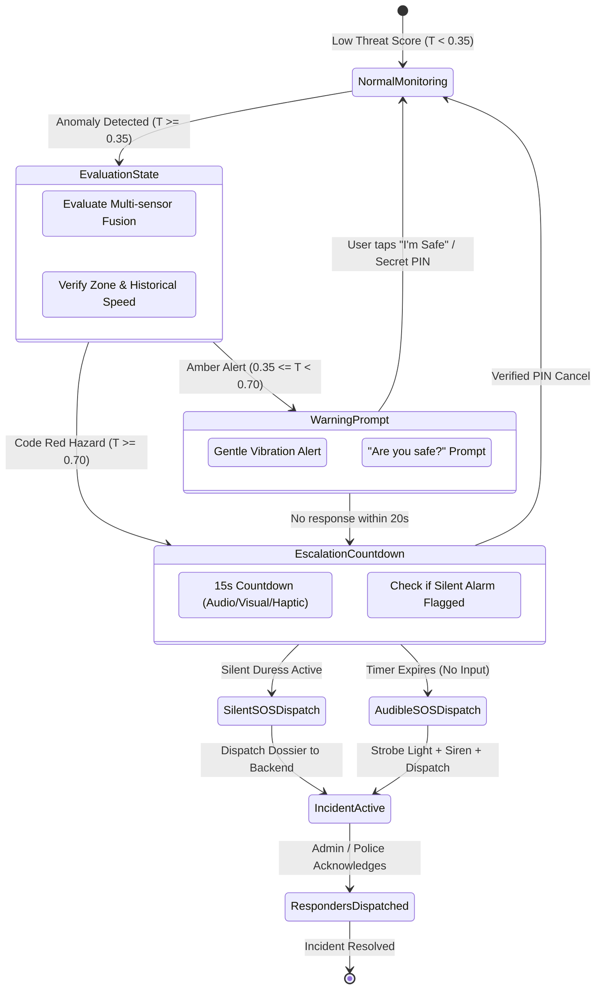
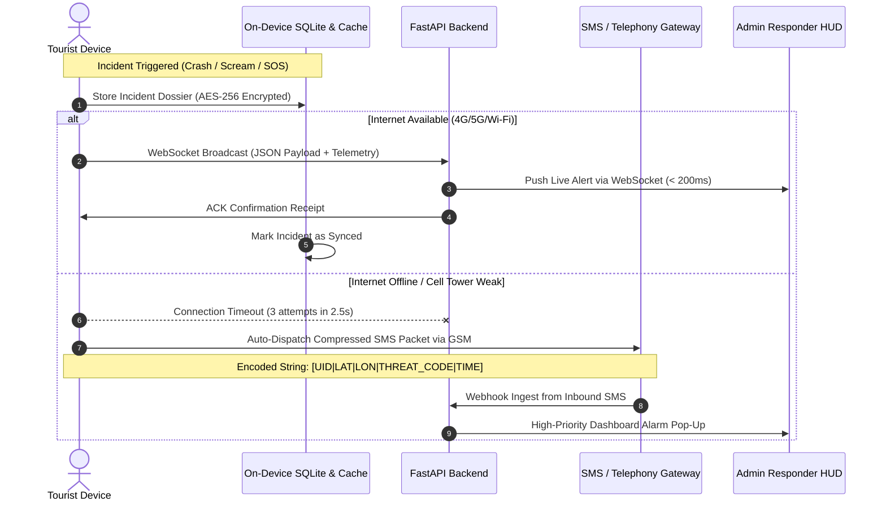
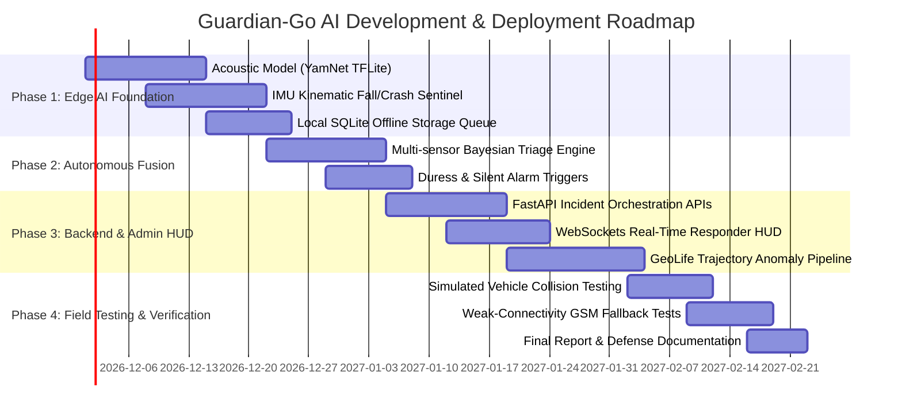

# GUARDIAN-GO AI: Autonomous Multimodal Emergency Detection & Incident Response System
**Comprehensive Engineering Blueprint, Research Architecture, App Design, and Implementation Roadmap**

---

## 1. Executive Overview & Problem-Solution Matrix

Modern personal safety systems fail during true emergencies because they inherently rely on **deliberate human action**: an injured, panicked, incapacitated, or assaulted tourist cannot unlock their phone, open an app, navigate screens, or verbally explain their coordinates over a phone line.

**Guardian-Go AI** evolves the core Guardian-Go prototype (GPS tracking + Haversine geofencing + manual SOS) into an **Autonomous, Edge-to-Cloud Multimodal Emergency AI Agent**. The system continuously monitors sensor streams (acoustic, kinematic, spatial, visual) to detect, triage, and dispatch emergencies **passively and hands-free**, while maintaining absolute privacy, low battery consumption, and offline resilience.

### 1.1 Emergency Typology & AI Response Matrix

| Emergency Type | Primary Detection Trigger | AI Agent Behavior | Action & Notification Pipeline |
| :--- | :--- | :--- | :--- |
| **Physical Attack / Coercion** | Secret duress vocal trigger ("Blue Orchid"), vocal distress/screams, sudden erratic sprinting followed by struggle patterns. | **Silent Duress Protocol**: Screen appears normal or off; covertly records 10s ambient audio, captures front/back camera photos. | Silent telemetry packet dispatched via WebSockets/FCM/SMS to Police & Admin Dashboard. Live audio & route tracking initiated. |
| **Severe Vehicle Accident / Impact** | IMU (Accelerometer/Gyroscope) High-G spike (>3.5g) followed by immediate rotational tumble and prolonged stillness. | **Collision Triage**: 15-second haptic/audio countdown with "Cancel False Alarm" slider. | If no cancel: "Code Red Accident" SOS triggered with exact GPS, speed at impact, heading, and nearest emergency trauma centers. |
| **Medical Emergency / Sudden Collapse** | Vertical elevation drop within 0.4s + zero recovery movement (IMU) + shallow breathing/distress sounds or silence. | **Dead-Man's Timer & Health Interrogation**: Audible voice prompt: *"Are you okay? Tap screen or say 'I am fine'"*. | If unresponsive: Dispatches Medical SOS containing Blood Group, Pre-existing conditions, emergency contacts, and GPS pin. |
| **Wilderness Disorientation / Danger Zone Straying** | Trajectory anomaly (LSTM/Autoencoder deviation from GeoLife baseline) + crossing into geo-polygon danger zone. | **Preventive Warning Agent**: Generates proactive conversational or haptic warning before tourist enters hazards (e.g., cliff, animal corridor). | In-app visual rerouting advice; updates Admin dashboard risk level from "Green" to "Amber". |

---

## 2. End-to-End System Architecture

The architecture uses a **hybrid edge-cloud paradigm**: low-latency, privacy-sensitive anomaly detection runs locally on the mobile device (Flutter + native Android/iOS C++ kernels via TFLite), while high-throughput triage, incident correlation, clustering, and administrative telemetry dispatch run on the FastAPI backend and PostgreSQL database.

```mermaid
flowchart TD
    subgraph MobileDevice["Tourist Mobile Device (Edge Layer)"]
        Sensors["Device Sensors\n(GPS, IMU, Mic, Camera)"]
        EdgePipeline["Edge AI Pre-Processing Engine\n(TFLite / MediaPipe / Fast-DTW)"]
        Sensors --> EdgePipeline
        
        Acoustic["Acoustic Agent\n(YamNet Screams & Keywords)"]
        Kinematic["Kinematic Agent\n(Fall / Impact Detector)"]
        Vision["Vision Agent\n(Facial Agony & Covert Capture)"]
        Spatial["Spatial Agent\n(Haversine + Offline Geofence)"]
        
        EdgePipeline --> Acoustic
        EdgePipeline --> Kinematic
        EdgePipeline --> Vision
        EdgePipeline --> Spatial
        
        LocalFusion["Multimodal Fusion & Triage Core\n(Calculates Local Threat Score $S_t$)"]
        Acoustic --> LocalFusion
        Kinematic --> LocalFusion
        Vision --> LocalFusion
        Spatial --> LocalFusion
        
        OfflineCache["Offline SQLite Buffer\n+ SMS Failover Manager"]
        LocalFusion --> OfflineCache
    end

    subgraph Network["Communication Channels"]
        WS["Secure WebSockets (Live Sync)"]
        REST["FastAPI HTTPS Gateway"]
        GSM["Cellular GSM / SMS Gateway (Fallback)"]
    end

    LocalFusion -->|Online| WS
    LocalFusion -->|Online| REST
    OfflineCache -->|No Data Connection| GSM

    subgraph Backend["Guardian-Go Cloud Platform"]
        API["FastAPI Orchestration Gateway"]
        Auth["Firebase Admin Token Verifier"]
        Postgres[(PostgreSQL + PostGIS DB)]
        RiskEngine["Predictive ML Risk Engine\n(GeoLife Anomaly Scorer)"]
        Dispatcher["Emergency Dispatch Broker\n(Twilio, FCM, Webhooks)"]

        WS --> API
        REST --> API
        GSM --> Dispatcher
        API --> Auth
        API --> Postgres
        API --> RiskEngine
        API --> Dispatcher
    end

    subgraph Dashboard["First Responder & Admin Center"]
        AdminUI["Live Web Dashboard\n(Leaflet / OpenStreetMap HUD)"]
        SMSAlerts["Direct Responders / Local Police / Family"]
        Dispatcher --> AdminUI
        Dispatcher --> SMSAlerts
    end
```



---

## 3. Multimodal AI Agent Modules & Technical Formulations

### Module A: Acoustic & Voice Distress Agent
1. **Always-Listening Low-Power Pipeline**:
   - Uses an on-device VAD (Voice Activity Detection, e.g., Silero-VAD) to ignore background silence.
   - Micro-keyword spotting for user-customizable duress triggers (e.g., *"Emergency"*, *"Help me"*, or discreet phrases like *"The sky is red"*).
2. **Acoustic Event Detection (YamNet / Audio Spectrogram Transformer)**:
   - Model: Mobile-optimized TFLite YAMNet trained on AudioSet.
   - Target Classes: `Scream (Class 14)`, `Shout (Class 12)`, `Groan/Sigh (Class 18)`, `Glass Breaking (Class 434)`, `Gunshot/Explosion (Class 428)`.
   - Sliding window of $975\text{ ms}$ with $50\%$ overlap.
   - Classification output generates Acoustic Threat Score:
     $$A_t = \max_{c \in \text{Threat Classes}} P(c \mid \text{Spectrogram})$$

### Module B: Kinematic Impact & Fall Detection Agent
1. **Tri-Axial Accelerometer & Gyroscope Fusion**:
   - Continuous vector magnitude calculation:
     $$A_{\text{mag}}(t) = \sqrt{a_x^2(t) + a_y^2(t) + a_z^2(t)}$$
     $$\omega_{\text{mag}}(t) = \sqrt{\omega_x^2(t) + \omega_y^2(t) + \omega_z^2(t)}$$
2. **Accident / Hard Fall Criteria**:
   - **Phase 1 (Free fall / Weightlessness)**: $A_{\text{mag}} < 0.5g$ for $\Delta t \in [80\text{ ms}, 400\text{ ms}]$.
   - **Phase 2 (Impact Peak)**: $A_{\text{mag}} \ge 3.5g$ (Falls) or $\ge 5.0g$ (Vehicle Collisions).
   - **Phase 3 (Orientation Displacement)**: Angular tilt change $\Delta \theta > 60^\circ$ calculated via complementary filter.
   - **Phase 4 (Prolonged Post-Impact Immobility)**: Variance of acceleration $\sigma^2(A_{\text{mag}}) < 0.05g^2$ sustained over $10\text{ seconds}$.
   - If Phases 1–4 correlate, the Kinematic Threat Score is set to $K_t = 1.0$.

### Module C: Vision & Facial/Postural Distress Agent
1. **On-Demand Camera Trigger**:
   - The camera is **never** left continuously streaming to preserve user privacy and battery life.
   - The camera triggers *only* when $A_t \ge 0.65$ or $K_t \ge 0.70$, or upon user touch-hold duress.
2. **Facial Agony / Panic Analysis**:
   - MediaPipe Face Mesh extracts 468 landmark coordinates.
   - Extracts Action Units (FACS): AU4 (Brow Lowerer), AU7 (Lid Tightener), AU20 (Lip Stretcher), AU25/26 (Jaw Drop).
   - Calculates Agony / Extreme Pain Index ($V_t$).
3. **Evidence Snapshot Package**:
   - Simultaneously captures one front camera frame and one rear camera frame.
   - Frames are AES-256 encrypted locally, sent directly in the emergency alert dossier, and destroyed from device storage.

### Module D: Spatio-Temporal GPS Anomaly Agent
1. **Haversine Geofencing (Deterministic)**:
   $$d = 2R \arcsin\left(\sqrt{\sin^2\left(\frac{\Delta\phi}{2}\right) + \cos\phi_1\cos\phi_2\sin^2\left(\frac{\Delta\lambda}{2}\right)}\right)$$
   Evaluated against polygonal or circular danger/safe zones.
2. **Trajectory Deviation Model (GeoLife Trained Anomaly Engine)**:
   - Trained on Microsoft GeoLife GPS Trajectory dataset (17,621 trajectories, 1.2 million kilometers).
   - Sequence representation: vector of tuples $(lat_i, lon_i, \Delta t_i, \text{speed}_i, \text{heading}_i)$.
   - An autoencoder / Isolation Forest predicts probability of route anomaly:
     $$G_t = 1 - P(\text{normal trajectory} \mid \text{historical cluster})$$
   - High $G_t$ combined with entry into isolated terrain triggers predictive intervention before distress occurs.

---

## 4. Autonomous Triage & Incident Fusion Engine

To prevent false alarms while never missing a genuine crisis, the system uses a **Bayesian Multi-Sensor Fusion Rule**:

$$\text{Threat Level } \mathcal{T} = w_A A_t + w_K K_t + w_V V_t + w_G G_t$$

Where dynamic weights satisfy $\sum w_i = 1.0$, adjusted based on sensor confidence and contextual environmental noise.



---

## 5. UI/UX Mobile Application Design Specification

### 5.1 Design Philosophy & Color Palette
- **High Stress Usability**: 60-30-10 dark mode design to preserve OLED battery and prevent glare during night operations.
- **Color System**:
  - `Background Primary`: `#0B0F19` (Obsidian Navy)
  - `Surface Card`: `#161F30` (Steel Slate)
  - `Accent Safe`: `#10B981` (Emerald Green)
  - `Accent Warning`: `#F59E0B` (Amber Shield)
  - `Accent Emergency (Code Red)`: `#EF4444` (Crimson Pulse)
  - `Text Primary`: `#F9FAFB`
  - `Text Muted`: `#9CA3AF`

### 5.2 Core Screen Layouts

#### Screen 1: Autonomous Safety HUD (Home View)
```
+--------------------------------------------------------+
|  [≡] GUARDIAN GO AI                    [Battery: 88%]  |
+--------------------------------------------------------+
|                                                        |
|   +------------------------------------------------+   |
|   |  LIVE STATUS: SECURE                           |   |
|   |  Current Zone: Manali Valley Route (Safe)      |   |
|   |  AI Sentinel: Active (Acoustic + Fall Detect)  |   |
|   +------------------------------------------------+   |
|                                                        |
|   [================= LIVE MAP =================]       |
|   |                                            |       |
|   |         ( ) Safe Haven                     |       |
|   |             \                              |       |
|   |              ● [You Are Here]              |       |
|   |               \                            |       |
|   |            [ ! Danger Zone: Cliff Pass ]   |       |
|   |                                            |       |
|   +--------------------------------------------+       |
|                                                        |
|   +------------------------------------------------+   |
|   |       AI INCIDENT RISK INDEX: LOW (12%)        |   |
|   |   Terrain: Stable | Network: 4G LTE | Vitals: OK|  |
|   +------------------------------------------------+   |
|                                                        |
|                      (( SOS ))                         |
|             [ HOLD 3 SEC FOR INSTANT SOS ]             |
|                                                        |
+--------------------------------------------------------+
|  [Map]      [Trip AI]      [Audio Shield]      [Profile]
+--------------------------------------------------------+
```

#### Screen 2: Code Red Emergency Countdown & Triage Screen
```
+--------------------------------------------------------+
|                      EMERGENCY!                        |
|             HARD IMPACT / CRASH DETECTED               |
+--------------------------------------------------------+
|                                                        |
|                        / ! \                           |
|                       /     \                          |
|                      /   12  \                         |
|                     +---------+                        |
|                 SECONDS TO AUTO-DISPATCH               |
|                                                        |
|   Emergency Contacts & Local Authorities will receive: |
|   • Exact Coordinates: 32.2396° N, 77.1887° E         |
|   • Medical Profile: Type O+, Penicillin Allergy       |
|   • 10s Ambient Audio & Evidence Photos                |
|                                                        |
|   [>>> SLIDE TO CANCEL (ENTER SAFE PIN) >>>>>>]        |
|                                                        |
|             [ TRIGGER SILENT SOS NOW ]                 |
+--------------------------------------------------------+
```

---

## 6. Real-Time Working Protocol & Network Failover Architecture

To guarantee **100% real-time reliability** even when cellular networks fail in remote hills, dense forests, or during disaster scenarios:



---

## 7. Concrete Implementation Codebase

### 7.1 FastAPI Backend Incident Intake & Triage Engine
Below is the ready-to-run, production-structured FastAPI endpoint handling multimodal telemetry intake, user verification, and emergency dispatch:

```python
# app/routers/incidents.py
from fastapi import APIRouter, Depends, HTTPException, status
from pydantic import BaseModel, Field
from typing import Optional, List
import datetime
from sqlalchemy.orm import Session
from app.database import get_db
from app.models import User, IncidentAlert, LocationPing, Zone
from app.services.auth import verify_firebase_token
from app.services.notifier import trigger_responder_notification
import math

router = APIRouter(prefix="/api/v1/incidents", tags=["Autonomous Incidents"])

class IncidentTelemetry(BaseModel):
    latitude: float = Field(..., ge=-90.0, le=90.0)
    longitude: float = Field(..., ge=-180.0, le=180.0)
    threat_category: str = Field(..., example="HARD_FALL_COLLISION") # ATTACK, CRASH, MEDICAL, DANGER_ZONE
    threat_score: float = Field(..., ge=0.0, le=1.0)
    acoustic_confidence: Optional[float] = 0.0
    kinematic_g_force: Optional[float] = 1.0
    is_silent_duress: bool = False
    evidence_audio_url: Optional[str] = None
    evidence_snapshot_url: Optional[str] = None

def haversine_distance(lat1: float, lon1: float, lat2: float, lon2: float) -> float:
    R = 6371000.0  # Earth radius in meters
    phi1, phi2 = math.radians(lat1), math.radians(lat2)
    delta_phi = math.radians(lat2 - lat1)
    delta_lambda = math.radians(lon2 - lon1)
    a = math.sin(delta_phi / 2)**2 + math.cos(phi1) * math.cos(phi2) * math.sin(delta_lambda / 2)**2
    c = 2 * math.atan2(math.sqrt(a), math.sqrt(1 - a))
    return R * c

@router.post("/dispatch", status_code=status.HTTP_201_CREATED)
async def dispatch_incident(
    telemetry: IncidentTelemetry,
    db: Session = Depends(get_db),
    user_payload: dict = Depends(verify_firebase_token)
):
    uid = user_payload.get("uid")
    user = db.query(User).filter(User.id == uid).first()
    if not user:
        raise HTTPException(status_code=404, detail="User identity not found.")

    # 1. Store latest Location Ping
    ping = LocationPing(
        user_id=uid,
        latitude=telemetry.latitude,
        longitude=telemetry.longitude,
        timestamp=datetime.datetime.utcnow()
    )
    db.add(ping)

    # 2. Check Proximity to Known Hazard/Danger Zones
    nearby_zones = db.query(Zone).all()
    in_danger_zone = False
    active_zone_name = None
    for zone in nearby_zones:
        dist = haversine_distance(telemetry.latitude, telemetry.longitude, zone.centre_latitude, zone.centre_longitude)
        if dist <= zone.radius:
            if zone.type.lower() == "danger":
                in_danger_zone = True
                active_zone_name = zone.name

    # 3. Create High-Priority Incident Record
    incident = IncidentAlert(
        user_id=uid,
        latitude=telemetry.latitude,
        longitude=telemetry.longitude,
        threat_type=telemetry.threat_category,
        threat_score=telemetry.threat_score,
        in_danger_zone=in_danger_zone,
        zone_name=active_zone_name,
        is_silent=telemetry.is_silent_duress,
        status="ACTIVE_UNRESOLVED",
        timestamp=datetime.datetime.utcnow()
    )
    db.add(incident)
    db.commit()
    db.refresh(incident)

    # 4. Trigger Real-Time Notification Pipeline (WebSockets, SMS, Admin Alerts)
    dispatch_payload = {
        "incident_id": incident.id,
        "user_name": user.email,
        "coordinates": {"lat": telemetry.latitude, "lon": telemetry.longitude},
        "threat_type": telemetry.threat_category,
        "threat_score": telemetry.threat_score,
        "is_silent": telemetry.is_silent_duress,
        "timestamp": incident.timestamp.isoformat()
    }
    await trigger_responder_notification(dispatch_payload)

    return {
        "status": "DISPATCHED",
        "incident_id": incident.id,
        "zone_alert": active_zone_name if in_danger_zone else "CLEAR"
    }
```

### 7.2 Flutter Sensor Daemon & Impact Detection Service
This Dart service runs continuously in the background on the mobile device, aggregating accelerometer events and triggering the triage sequence:

```dart
// lib/services/kinematic_sentinel_service.dart
import 'dart:async';
import 'dart:math';
import 'package:sensors_plus/sensors_plus.dart';
import 'package:flutter/foundation.dart';

enum ThreatState { normal, warning, countdown, dispatched }

class KinematicSentinelService {
  static const double impactGThreshold = 3.8; // G-force spike threshold
  static const double freeFallGThreshold = 0.45; // Weightlessness threshold
  
  bool _isInFreeFall = false;
  DateTime? _freeFallTimestamp;
  StreamSubscription<AccelerometerEvent>? _accelSub;
  
  Function(double maxG, String reason)? onCriticalEmergencyTriggered;

  void startMonitoring() {
    _accelSub = accelerometerEventStream().listen((AccelerometerEvent event) {
      // Calculate scalar magnitude in standard gravity units (1g ~= 9.81 m/s^2)
      double totalAcc = sqrt(event.x * event.x + event.y * event.y + event.z * event.z);
      double gForce = totalAcc / 9.81;

      // Step 1: Detect sudden free-fall phase
      if (gForce < freeFallGThreshold) {
        _isInFreeFall = true;
        _freeFallTimestamp = DateTime.now();
        return;
      }

      // Step 2: Correlate with severe impact peak
      if (gForce >= impactGThreshold) {
        if (_isInFreeFall && _freeFallTimestamp != null) {
          int diffMs = DateTime.now().difference(_freeFallTimestamp!).inMilliseconds;
          if (diffMs <= 500) {
            // High confidence fall/crash detected
            _handleEmergencyDetected(gForce, "FALL_AND_IMPACT");
            _resetState();
            return;
          }
        } else {
          // Direct high-G blunt impact (e.g., vehicle collision or assault)
          _handleEmergencyDetected(gForce, "DIRECT_HIGH_G_COLLISION");
          _resetState();
        }
      }
    });
  }

  void _handleEmergencyDetected(double peakG, String cause) {
    debugPrint("[Sentinel] CRITICAL ANOMALY DETECTED: $cause with ${peakG.toStringAsFixed(2)}G");
    if (onCriticalEmergencyTriggered != null) {
      onCriticalEmergencyTriggered!(peakG, cause);
    }
  }

  void _resetState() {
    _isInFreeFall = false;
    _freeFallTimestamp = null;
  }

  void dispose() {
    _accelSub?.cancel();
  }
}
```

---

## 8. Project Execution Roadmap & Milestones



### Detailed Sprint Breakdown
- **Sprint 1 (Weeks 1–2): Local Edge Perception**
  - Integrate `sensors_plus` and calibrate noise filtering algorithms for normal walking vs running vs violent vehicular collisions.
  - Package quantized TFLite models for offline acoustic classification.
- **Sprint 2 (Weeks 3–4): Autonomous Triage & Local HMI**
  - Construct the 15-second haptic countdown modal with biometric/PIN cancellation.
  - Implement covert dual-camera photo snap and encrypted local caching.
- **Sprint 3 (Weeks 5–6): FastAPI Incident Cloud & WebSocket Real-Time Sync**
  - Implement `/api/v1/incidents/dispatch` with database persistence.
  - Upgrade the Admin Dashboard with Leaflet audio-visual flashing pins and incident sound alarms.
- **Sprint 4 (Weeks 7–8): Trajectory Intelligence & Hardware-in-the-Loop Testing**
  - Clean and cluster the Microsoft GeoLife trajectory dataset to produce spatial anomaly bounds.
  - Conduct live field trials using Android emulator route simulators and physical devices.

---

## 9. Research Foundations & Academic Citations

1. **Y. Zheng, et al.**, *"Mining Interesting Locations and Travel Sequences from GPS Trajectories"*, ACM WWW, 2009. (Basis for GeoLife Anomaly Model).
2. **J. F. Gemmeke, et al.**, *"Audio Set: An ontology and human-labeled dataset for audio events"*, IEEE ICASSP, 2017. (Underpins YamNet Acoustic Screaming Detection).
3. **P. Pierleoni, et al.**, *"A High-Reliability Wearable Fall Detection System Using Tri-Axial Accelerometers and Gyroscopes"*, IEEE Sensors Journal, 2015.
4. **Google MediaPipe Team**, *"Real-time Facial Landmark and Expression Recognition on Mobile Devices"*, Google Research, 2020.
5. **R. W. Sinnott**, *"Virtues of the Haversine"*, Sky and Telescope, vol. 68, no. 2, p. 159, 1984.
