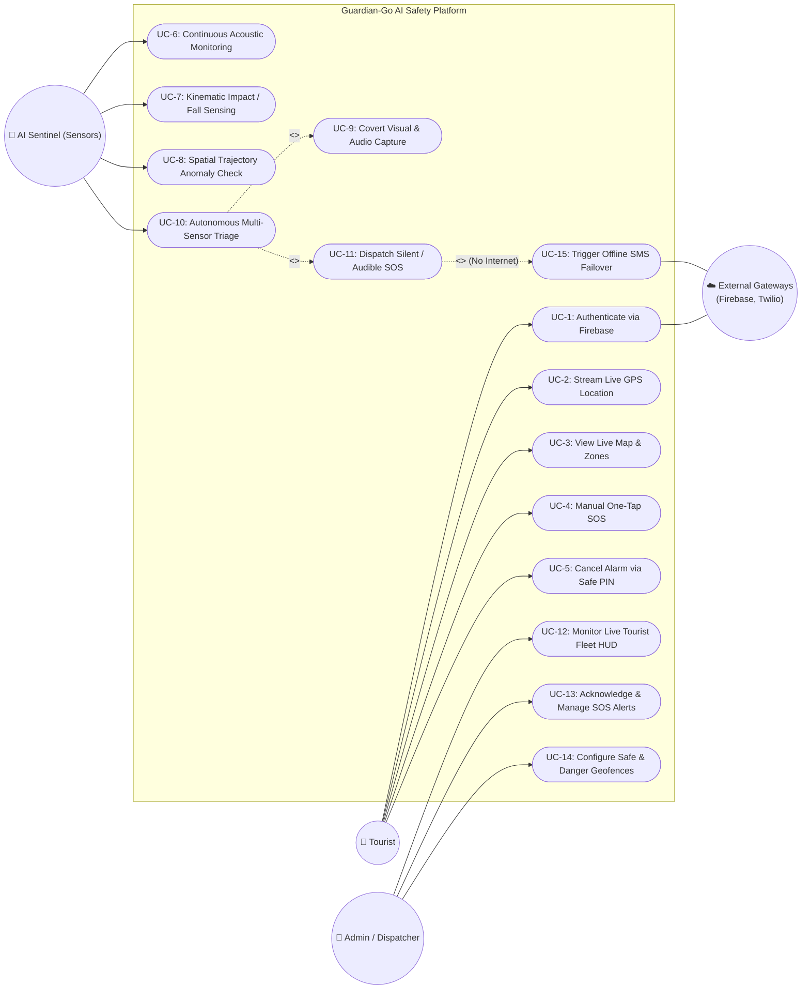
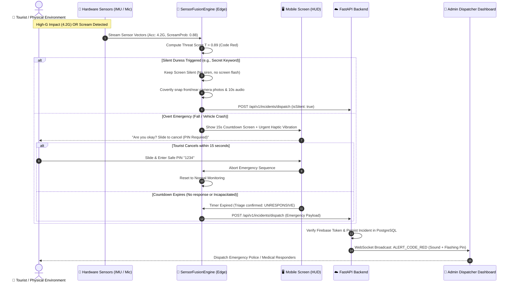
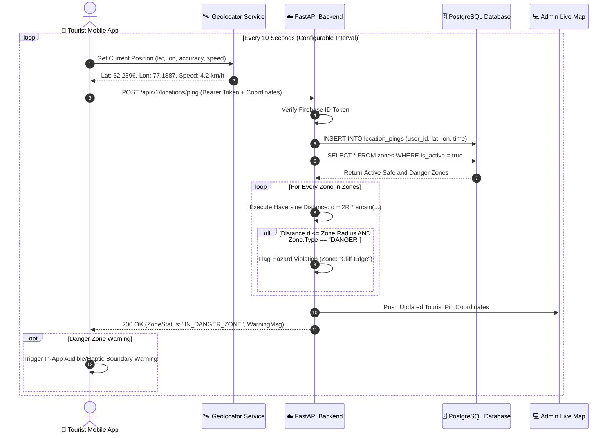
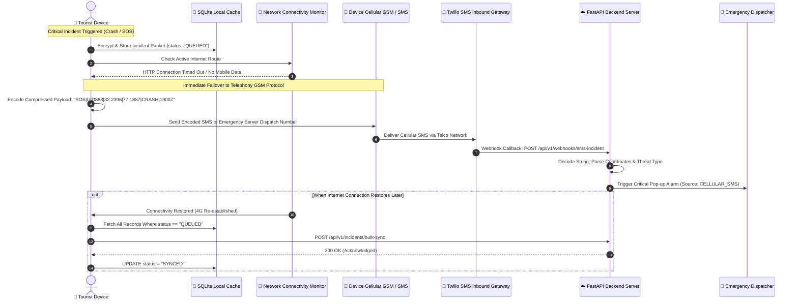
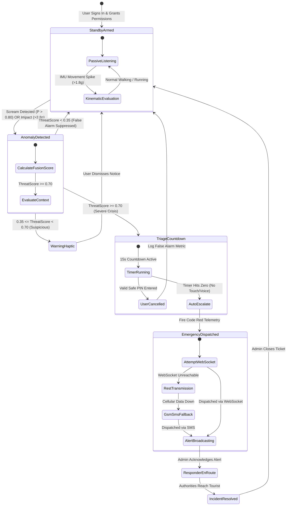
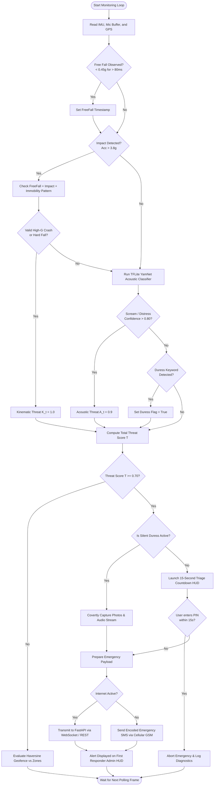
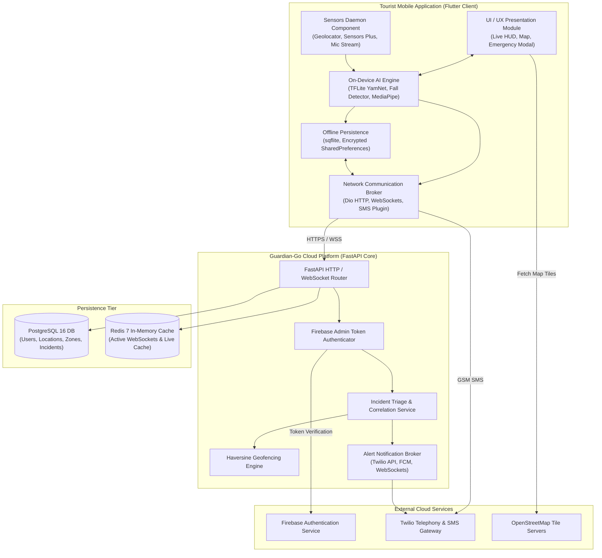
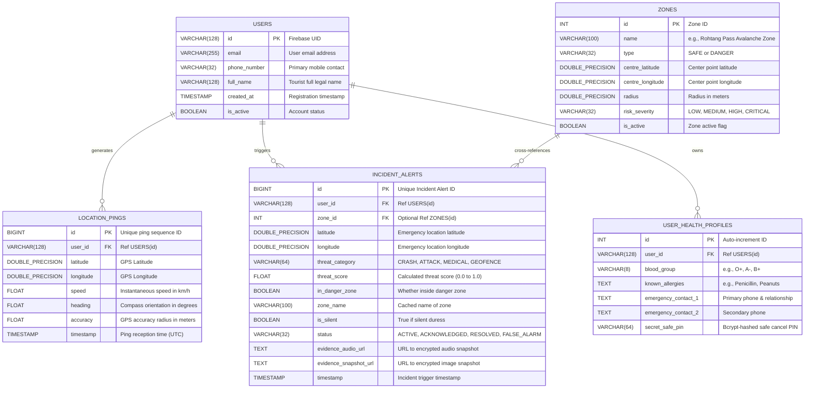

# GUARDIAN-GO AI: Complete UML Diagrams & Architectural Specifications
**Unified Modeling Language (UML 2.5) Documentation for Academic Report and Production Engineering**

---

## Table of Contents
1. [Use Case Diagram & Actor Specifications](#1-use-case-diagram)
2. [Comprehensive System Class Diagram](#2-system-class-diagram)
3. [Sequence Diagrams](#3-sequence-diagrams)
   - [3.1 Autonomous Multimodal Incident Detection & Dispatch](#31-autonomous-multimodal-incident-detection--dispatch)
   - [3.2 Periodic Location Tracking & Haversine Geofencing](#32-periodic-location-tracking--haversine-geofencing)
   - [3.3 Zero-Connectivity Network Failover & SMS Gateway](#33-zero-connectivity-network-failover--sms-gateway)
4. [State Machine Diagram (Incident Lifecycle & Sensor Sentinel)](#4-state-machine-diagram)
5. [Activity Diagram (Autonomous Sensing, Triage & Escalation Workflow)](#5-activity-diagram)
6. [Component Diagram (Software Subsystems & Interfaces)](#6-component-diagram)
7. [Deployment Diagram (Physical Nodes & Execution Environments)](#7-deployment-diagram)
8. [Entity-Relationship (ER) Diagram (Database Schema)](#8-entity-relationship-er-diagram)

---

## 1. Use Case Diagram

The use case diagram illustrates the functional interactions between four key actors:
- **Tourist**: The primary mobile end-user.
- **Autonomous AI Sentinel**: On-device background sensing and anomaly inference system.
- **Administrator / Police Dispatcher**: First responders monitoring the live emergency HUD.
- **External Gateway Services**: Firebase Authentication and Cellular SMS/Twilio Gateway.



---

## 2. System Class Diagram

The class diagram captures both the **Mobile Client Edge Architecture** (Flutter/Dart + On-Device AI models) and the **FastAPI Cloud Backend Architecture** (Python/SQLAlchemy + Database Models).

```mermaid
classDiagram
    %% =======================
    %% MOBILE CLIENT EDGE LAYER
    %% =======================
    class SensorSentinel {
        <<interface>>
        +startMonitoring() void
        +stopMonitoring() void
        +isCalibrated() bool
    }

    class KinematicSentinelService {
        -double impactGThreshold
        -double freeFallGThreshold
        -bool isInFreeFall
        -DateTime freeFallTimestamp
        +startMonitoring() void
        +stopMonitoring() void
        +calculateMagnitude(x, y, z) double
        -_handleImpactDetected(peakG, reason) void
    }

    class AcousticSentinelService {
        -double screamConfidenceThreshold
        -String duressPassphrase
        -TFLiteInterpreter yamnetInterpreter
        +startMonitoring() void
        +processAudioBuffer(byte[] pcmData) double
        +detectDuressPhrase(String transcribedText) bool
    }

    class VisionCaptureService {
        -bool isCameraArmed
        +captureCovertEvidence() EvidencePackage
        +analyzeFacialAgony(CameraImage frame) double
    }

    class MultiSensorFusionEngine {
        -double currentThreatScore
        -ThreatLevel systemState
        +evaluateSensors(AcousticScore, KinematicScore, SpatialScore) double
        +triggerTriageCountdown(double threatScore, String triggerType) void
        +abortCountdown(String enteredPin) bool
        +dispatchImmediateAlert(bool isSilent) void
    }

    class OfflineQueueManager {
        -SQLiteDatabase localDb
        +enqueueIncident(IncidentPayload payload) void
        +getPendingPackets() List~IncidentPayload~
        +markSynced(String incidentId) void
        +dispatchViaGsmSms(IncidentPayload payload) bool
    }

    SensorSentinel <|.. KinematicSentinelService
    SensorSentinel <|.. AcousticSentinelService
    MultiSensorFusionEngine --> KinematicSentinelService : listens to
    MultiSensorFusionEngine --> AcousticSentinelService : listens to
    MultiSensorFusionEngine --> VisionCaptureService : triggers
    MultiSensorFusionEngine --> OfflineQueueManager : persists/fails over

    %% ========================
    %% BACKEND ORCHESTRATION & DB
    %% ========================
    class IncidentOrchestrationService {
        +verifyToken(String idToken) UserPayload
        +ingestIncident(IncidentTelemetry telemetry) IncidentResponse
        +evaluateGeofence(double lat, double lon) GeofenceResult
        +broadcastWebSocketAlert(IncidentAlert alert) void
    }

    class HaversineCalculator {
        <<utility>>
        +EARTH_RADIUS_METERS double
        +computeDistance(lat1, lon1, lat2, lon2) double
        +isInsideZone(touristLat, touristLon, zone) bool
    }

    class User {
        +String id (Firebase UID)
        +String email
        +String emergencyContactPhone
        +String medicalBloodGroup
        +DateTime createdAt
    }

    class LocationPing {
        +int id
        +String userId
        +double latitude
        +double longitude
        +double speed
        +DateTime timestamp
    }

    class Zone {
        +int id
        +String name
        +String type
        +double centreLatitude
        +double centreLongitude
        +double radius
        +String riskSeverity
    }

    class IncidentAlert {
        +int id
        +String userId
        +double latitude
        +double longitude
        +String threatCategory
        +double threatScore
        +bool inDangerZone
        +String zoneName
        +bool isSilent
        +String status
        +String evidenceAudioUrl
        +String evidenceSnapshotUrl
        +DateTime timestamp
    }

    IncidentOrchestrationService --> HaversineCalculator : uses
    IncidentOrchestrationService --> User : queries
    IncidentOrchestrationService --> IncidentAlert : creates
    IncidentOrchestrationService --> LocationPing : appends
    IncidentOrchestrationService --> Zone : checks against

    User "1" -- "0..*" LocationPing : generates
    User "1" -- "0..*" IncidentAlert : triggers
```



---

## 3. Sequence Diagrams

### 3.1 Autonomous Multimodal Incident Detection & Dispatch
This sequence details a real-time event: an attacker confronts the tourist or a severe fall/impact occurs, causing hands-free autonomous detection, countdown, and instant dispatch.



---

### 3.2 Periodic Location Tracking & Haversine Geofencing
Shows the continuous cycle of tracking tourist movement and assessing danger zone violations.



---

### 3.3 Zero-Connectivity Network Failover & SMS Gateway
Shows the resilience workflow when a tourist is lost in remote valleys without 4G/5G data coverage.



---

## 4. State Machine Diagram

Describes the complete lifecycle of the **On-Device Sentinel Agent** and the **Emergency Incident State Machine**.



---

## 5. Activity Diagram

The activity diagram models the operational business logic executed during every sensing interval.



---

## 6. Component Diagram

Illustrates the modular packaging and runtime dependencies between edge modules, cloud microservices, and external systems.



---

## 7. Deployment Diagram

Depicts the physical execution environment, containerization, protocol boundaries, and hardware nodes.

```mermaid
flowchart TD
    subgraph TouristDevice["📱 Client Physical Node (Android / iOS Device)"]
        MobileOS["Operating System (Android 14+ / iOS 17+)"]
        subgraph MobileAppRuntime["Flutter Application Sandbox"]
            DartVM["Dart Native Runtime + Flutter Engine"]
            TFLiteC["TensorFlow Lite C++ Runtime (Quantized Models)"]
            SQLiteEngine["SQLite Storage Engine (AES-256 Encrypted)"]
        end
        Hardware["Device Hardware: GPS Chip, Tri-Axial IMU, Microphone, Cameras, GSM Modem"]
        Hardware --> MobileAppRuntime
    end

    subgraph CloudInfra["☁️ Cloud Infrastructure (Linux VPS / Google Cloud / AWS)"]
        subgraph DockerEnv["Docker Container Environment"]
            NginxProxy["Nginx Reverse Proxy & SSL Termination\n(Ports 80 / 443)"]
            FastAPIApp["FastAPI ASGI Server (Uvicorn Workers)\n(Port 8000)"]
            NginxProxy --> FastAPIApp
        end

        subgraph DataTier["Managed Database Instances"]
            PGNode[("PostgreSQL 16 + PostGIS\n(Port 5432)")]
            RedisNode[("Redis Cluster\n(Port 6379)")]
        end
        FastAPIApp --> PGNode
        FastAPIApp --> RedisNode
    end

    subgraph AdminWorkstation["💻 First Responder Client (Web Browser)"]
        AdminBrowser["Chrome / Edge / Firefox\n(HTML5, Leaflet.js, WebSockets HUD)"]
    end

    subgraph ThirdPartyCloud["🌐 Third-Party SaaS"]
        FirebaseCloud["Google Firebase Auth Servers"]
        TwilioCloud["Twilio Global Telephony Cloud"]
    end

    %% Network Protocols
    TouristDevice -->|WSS / HTTPS (TLS 1.3)| NginxProxy
    TouristDevice -.->|Cellular GSM SMS / PDU Protocol| TwilioCloud
    TwilioCloud -->|Webhook HTTPS POST| NginxProxy
    AdminWorkstation -->|HTTPS / WSS (Port 443)| NginxProxy
    FastAPIApp -->|HTTPS REST| FirebaseCloud
```

---

## 8. Entity-Relationship (ER) Diagram

Represents the relational data model deployed on the PostgreSQL database, maintaining full referential integrity and data types.



---

## 9. Summary & Verification Matrix

| UML Diagram | Purpose & Architectural Role | Standard Used |
| :--- | :--- | :--- |
| **Use Case Diagram** | Maps external actors (Tourist, Admin, AI Sentinel, Gateways) against functional requirements. | UML 2.5 Use Case Standard |
| **Class Diagram** | Details OOP classes, attributes, methods, inheritance, and interfaces across mobile and cloud. | UML 2.5 Class Model |
| **Sequence Diagrams** | Proves step-by-step temporal event ordering for detection, tracking, and offline GSM failover. | UML 2.5 Interaction Sequence |
| **State Machine Diagram**| Documents deterministic states from idle monitoring to triage countdown and dispatch. | UML 2.5 Statechart Standard |
| **Activity Diagram** | Outlines business logic, sensor evaluation conditions, and decision trees. | UML 2.5 Activity Model |
| **Component Diagram** | Defines software subsystems, module loose coupling, and interface boundaries. | UML 2.5 Component Standard |
| **Deployment Diagram** | Specifies physical client nodes, network protocols (WSS/HTTPS/GSM), and server containers. | UML 2.5 Deployment Spec |
| **Entity-Relationship** | Formalizes database tables, foreign keys, data types, and multiplicities in PostgreSQL. | Crow's Foot Relational Standard |
